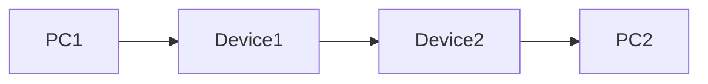

# Secure Inline TCP Channel

**Prepared by: Neli Hakobyan**

This is a classroom prototype for studying how two Linux devices can protect selected TCP payloads between PC1 and PC2.

> **Credit:** This study adaptation is based on the design and examples in [secure-inline-channel](https://github.com/arelibaghdadian/secure-inline-channel). The original project and its author should be credited when their code or ideas are reused.

## Network path



Device1 and Device2 sit between the computers. For selected TCP traffic, the devices establish a shared key, encrypt and authenticate payload data with AES-GCM, then verify and decrypt it at the other end. The IP and TCP headers are used for forwarding, and packet lengths and checksums are rebuilt after payload processing.

## What is included

- `device1/` — Device1 session setup and packet-handler examples
- `sec/` — shared cryptography, connection tracking, packet, and retransmission-cache helpers
- `checks/` — small learning examples and a read-only NFQUEUE inspector
- `docs/` — architecture and security notes
- `requirements.txt` — Python package versions
- `.gitignore` — files Git should leave out of version control

This folder contains Device1 examples and shared helpers. It does not contain a complete Device2 implementation or all Linux network setup scripts, so it is not a ready-to-run gateway.

## Requirements

Use Linux with Python 3. The packet examples also require network namespaces, NFQUEUE support, firewall rules, and administrator privileges in an isolated lab.

Install the listed Python packages with:

```bash
python3 -m pip install -r requirements.txt
```

## Learning checks

From this project folder, run a small check like this:

```bash
python3 -m checks.crypto_roundtrip
```

See `checks/README.md` for the other examples. The NFQUEUE inspector needs a configured lab queue and administrator privileges; it only displays packet details and accepts packets unchanged.

The Device1 session example is started with:

```bash
python3 -m device1.session
```

It expects Device2 to be listening at the address and port set in `device1/session.py`. The packet handler also requires a configured isolated network lab. Do not run it on networks you do not own or administer.

## Security limits

This project is for learning and demonstration, not production use. The sample X25519 exchange does not authenticate public keys, so a man-in-the-middle attack is possible. Its nonce and retransmission approach does not guarantee safety for every TCP lifecycle. Connection tracking, MTU handling, and fragmentation need more work. AES-GCM payload authentication does not automatically authenticate every IP or TCP header field.

Read `docs/security-analysis.md` and `docs/architecture.md` for more detail. Understand the design and mention the original source when you present or extend it.
